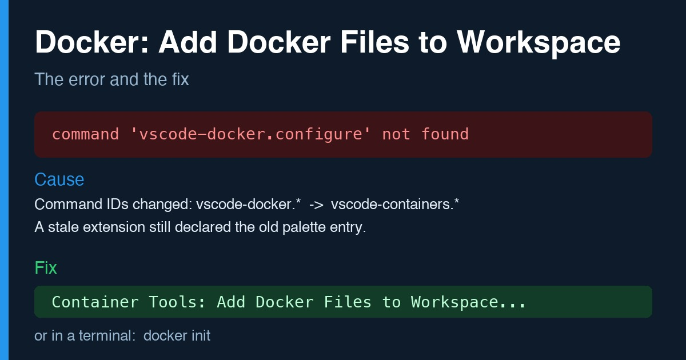

# Fixing "Docker: Add Docker Files to Workspace" in VS Code

Türkçe: [README.tr.md](README.tr.md)

In VS Code, the Command Palette entry `Docker: Add Docker Files to Workspace` fails with

    command 'vscode-docker.configure' not found

Short answer: since Docker extension 2.0.0 the features live in the Container Tools
extension and the command IDs changed from `vscode-docker.*` to `vscode-containers.*`.
Run `Container Tools: Add Docker Files to Workspace...` instead, or use `docker init`
in a terminal. If the old entry is still in your palette, an installed extension is
declaring it. Details below.

## Symptom

Selecting `Docker: Add Docker Files to Workspace` in the Command Palette
(`Cmd+Shift+P`) shows the error above. Uninstalling and reinstalling the Docker
extension, reloading the window, and quitting VS Code completely all leave the error
unchanged.

## Cause

Two things were stacked on top of each other.

1. Since version 2.0.0 (May 2025), the Microsoft Docker extension moved nearly all of
   its features into the Container Tools extension (`ms-azuretools.vscode-containers`).
   The Docker extension is now an extension pack that includes Container Tools.
   Command IDs changed too: the old `vscode-docker.configure` is now
   `vscode-containers.configure`.
2. One of the installed extensions, an older copy of the Docker extension, still
   contributed the old palette entry. So the "Docker: ..." line in the palette did not
   come from Microsoft's extension at all, and nothing handled the command it called.

That is why reinstalling did nothing: Microsoft's extension was not the broken part.

## How I found it

I looked for which installed extension declares the command ID. Search the
`package.json` of every installed extension for the old ID:

    grep -l '"vscode-docker.configure"' ~/.vscode/extensions/*/package.json

Only the old extension copy matched. The new ID does exist in Container Tools:

    grep -o '"command": *"vscode-containers.configure"' \
      ~/.vscode/extensions/ms-azuretools.vscode-containers-*/package.json

## Fix

1. Uninstall the extension that declares the old command (the `grep` above tells you
   which one it is).
2. Quit VS Code completely and reopen it.
3. In the Command Palette, run:

       Container Tools: Add Docker Files to Workspace...

To generate the same files without VS Code (`Dockerfile`, `compose.yaml`,
`.dockerignore`), run this in your project folder:

    docker init

After removing the stale extension, the command worked.

## Other Docker traps I hit along the way

All of these were real errors in the same session.

The `docker` CLI talks to the wrong runtime. If `DOCKER_HOST` is set in your shell
profile, it overrides the context you picked with `docker context use`. Before
assuming Docker Desktop is broken, check:

    echo $DOCKER_HOST
    docker context ls

`docker-credential-desktop` not found. If you install the Docker CLI with Homebrew and
Docker Desktop separately, `docker compose up` can fail with this error while pulling
images. The helper lives inside the Docker Desktop app folder. Without changing any
config, you can put it on the PATH for a single command:

    export PATH=/Applications/Docker.app/Contents/Resources/bin:$PATH

Moving from Colima to Docker Desktop. The two run in separate virtual machines and do
not share disks. Before deleting the old environment, check the following:

- Do the folders your containers bind-mount actually exist on the Mac? If a bind-mounted
  folder is missing on the Mac, the data may live only on the virtual machine's own
  disk. Deleting the old environment would destroy it.
- Use `docker save` and `docker load` for images, and a helper container running
  `tar` for volumes. Verify a backup by extracting it, not just by checking that the
  file exists. An empty archive can pass a naive check.
- Delete the old environment only after you have seen everything run in the new one.
  With Colima, the persistent data disk is not removed by `colima delete` unless you
  remove it separately, so it keeps taking space.

## What this repository does not contain

This is a write-up only. It has no keys, no `.env` files, no personal paths, and no
project configuration.
