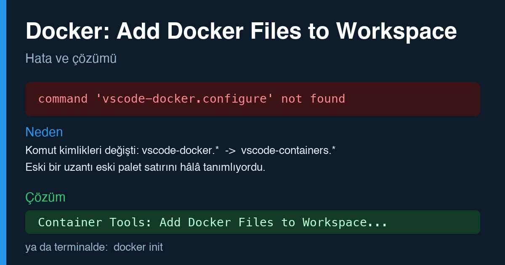

# VS Code'da "Docker: Add Docker Files to Workspace" hatasının çözümü

English: [README.md](README.md)

VS Code'da komut paletindeki `Docker: Add Docker Files to Workspace` şu hatayı veriyor:

    command 'vscode-docker.configure' not found

Kısa cevap: Docker uzantısı 2.0.0 sürümünden beri özelliklerini Container Tools
uzantısına taşıdı ve komut kimlikleri `vscode-docker.*` yerine
`vscode-containers.*` oldu. Bunun yerine `Container Tools: Add Docker Files to
Workspace...` komutunu çalıştırın ya da terminalde `docker init` kullanın. Eski
satır paletinizde hâlâ görünüyorsa, kurulu bir uzantı onu tanımlıyordur.
Ayrıntılar aşağıda.

## Belirti

Komut paletinde (`Cmd+Shift+P`) `Docker: Add Docker Files to Workspace` seçilince
yukarıdaki hata çıkıyor. Docker uzantısını silip yeniden yüklemek, pencereyi
yenilemek ve VS Code'u tamamen kapatıp açmak sonucu değiştirmiyor.

## Neden

İki şey üst üste biniyordu.

1. Microsoft'un Docker uzantısı 2.0.0 sürümünden (Mayıs 2025) beri neredeyse tüm
   özelliklerini Container Tools uzantısına (`ms-azuretools.vscode-containers`)
   taşıdı. Docker uzantısı artık Container Tools'u içeren bir paket. Komut
   kimlikleri de değişti: eski `vscode-docker.configure`, yeni adıyla
   `vscode-containers.configure`.
2. Kurulu uzantılardan biri (eski bir Docker uzantısının kopyası) paletteki eski
   satırı hâlâ tanımlıyordu. Yani palette gördüğünüz "Docker: ..." satırı
   Microsoft'un uzantısından gelmiyordu ve çağırdığı komutu karşılayan bir şey yoktu.

Yeniden kurulum bu yüzden işe yaramadı: bozuk olan Microsoft'un uzantısı değildi.

## Nasıl buldum

Eski komut kimliğini hangi uzantının tanımladığına baktım. Kurulu tüm uzantıların
`package.json` dosyalarında eski kimliği arayın:

    grep -l '"vscode-docker.configure"' ~/.vscode/extensions/*/package.json

Yalnızca eski uzantı kopyası çıktı. Yeni kimlik ise Container Tools içinde var:

    grep -o '"command": *"vscode-containers.configure"' \
      ~/.vscode/extensions/ms-azuretools.vscode-containers-*/package.json

## Çözüm

1. Eski komutu tanımlayan uzantıyı kaldırın (yukarıdaki `grep` hangisi olduğunu söyler).
2. VS Code'u tamamen kapatıp yeniden açın.
3. Komut paletinde şunu çalıştırın:

       Container Tools: Add Docker Files to Workspace...

VS Code kullanmadan aynı dosyaları (`Dockerfile`, `compose.yaml`, `.dockerignore`)
üretmek için proje klasöründe şunu çalıştırın:

    docker init

Eski uzantıyı kaldırdıktan sonra komut çalıştı.

## Yolda karşılaştığım diğer Docker tuzakları

Hepsi aynı oturumda çıkan gerçek hatalardı.

`docker` komutu yanlış ortama bağlanıyor. Kabuk ayarlarında `DOCKER_HOST`
tanımlıysa, `docker context use` ile seçtiğiniz bağlam yok sayılır. Docker
Desktop'ın bozuk olduğunu düşünmeden önce şunlara bakın:

    echo $DOCKER_HOST
    docker context ls

`docker-credential-desktop` bulunamadı. Docker CLI'yi Homebrew ile, Docker
Desktop'ı ayrıca kurarsanız, `docker compose up` imaj çekerken bu hatayı verebilir.
Yardımcı program Docker Desktop'ın uygulama klasöründe durur. Hiçbir ayarı
değiştirmeden, yalnızca tek komut için PATH'e ekleyebilirsiniz:

    export PATH=/Applications/Docker.app/Contents/Resources/bin:$PATH

Colima'dan Docker Desktop'a geçiş. İkisi ayrı sanal makinelerde çalışır ve diskleri
ortak değildir. Eski ortamı silmeden önce şunlara bakın:

- Konteynerlerinizin bind mount ettiği klasörler Mac'te gerçekten var mı? Bind
  mount edilen klasör Mac'te yoksa veri yalnızca sanal makinenin kendi diskinde
  olabilir. Eski ortamı silmek o veriyi yok eder.
- İmajlar için `docker save` ve `docker load`, volume'lar için yardımcı bir
  konteynerle `tar` kullanın. Yedeği yalnızca dosya var diye değil, içini açarak
  doğrulayın. Boş bir arşiv basit bir kontrolden geçebilir.
- Eski ortamı ancak yenisinde her şeyin çalıştığını gördükten sonra silin.
  Colima'da kalıcı veri diski, ayrıca silmediğiniz sürece `colima delete` ile
  gitmez ve yer kaplamaya devam eder.

## Bu depoda neler yok

Bu yalnızca bir çözüm yazısıdır. Anahtar, `.env` dosyası, kişisel yol ya da proje
yapılandırması içermez.
